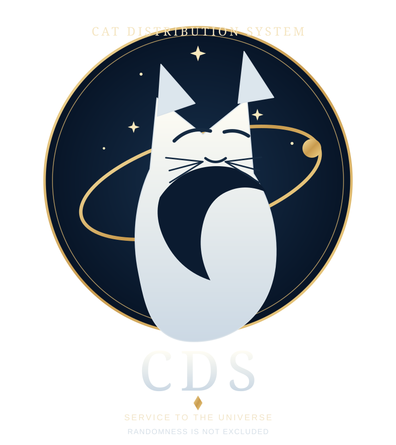

# CATIS

  

**Cat Allocation & Tracking Information System (CATIS)** is the technological platform supporting the **Cat Distribution System (CDS)**.

CATIS and CDS are distinct: CDS is the System; CATIS is its supporting technological platform.

## The Cat Distribution System (CDS)

The Cat Distribution System (CDS) is an independent system that determines the patterns governing the appearance of cats in people's lives and coordinates their allocation processes, taking into account individual circumstances and suitable conditions.

**Motto:** *Service to the universe. Randomness is not excluded.*

The CDS emblem is maintained in English as the international master artwork. A compact emblem mark is available for smaller interface and document uses.

## Official Languages

The Cat Distribution System (CDS) recognises the six official languages of the United Nations:

- English
- French
- Spanish
- Russian
- Chinese
- Arabic

English is the controlling language for international documentation. Official editions in the other five languages are maintained as parallel versions.

## Official Documentation

The following documents are maintained in all six official languages. English is the master edition.

| Document | Title |
|---|---|
| [CDS-DOC-001](docs/CDS-DOC-001.en.md) | Foundational Description |
| [CATIS-TECH-001](docs/CATIS-TECH-001.en.md) | CATIS Technical Platform Overview |
| [CDS-DOC-002](docs/CDS-DOC-002.en.md) | Terminology and Definitions |
| [CDS-PROC-001](docs/CDS-PROC-001.en.md) | Candidate Assessment Procedure |
| [CDS-REG-001](docs/CDS-REG-001.en.md) | System Notices and Administrative Communications |

Parallel language editions are available in the `.ru.md`, `.es.md`, `.fr.md`, `.zh.md`, and `.ar.md` files for each document.

## About this repository

This repository is the project repository for CATIS. It contains documentation and, as they are defined, the specifications and other materials relating to the platform.

The nature, origin, and internal mechanisms of CDS are not publicly explained. Its presence is observed through events, circumstances, and outcomes; its principles are not disclosed.

---

*CATIS — Cat Allocation & Tracking Information System*  
*Supporting the Cat Distribution System (CDS).*
